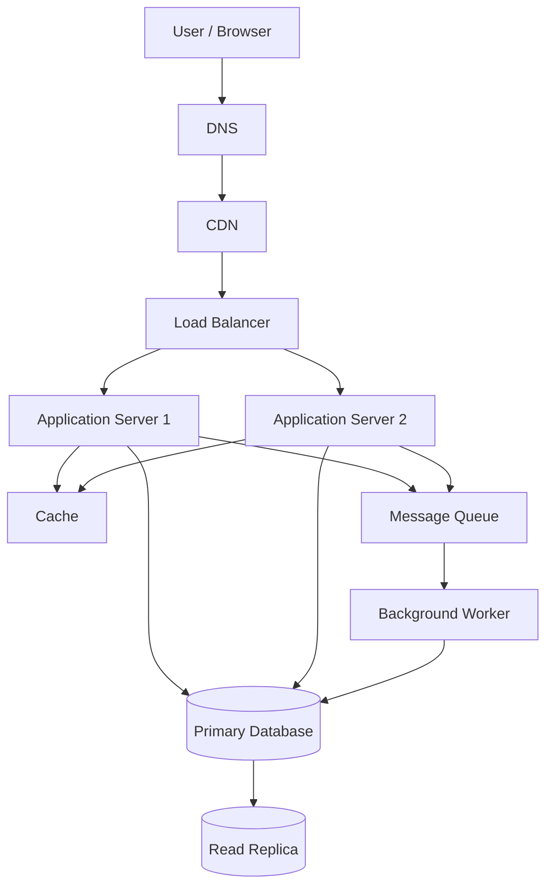

# QuickNotes System Architecture

## 1. Overview

QuickNotes is a notes application that allows users to create, view, update, delete, and organize notes. The system uses a web client, an API layer, and a relational database.

## 2. Functional Requirements

Functional requirements describe what the system must do.

1. Users can create an account and sign in.
2. Users can create notes with a title and body.
3. Users can view a list of their notes and open individual notes.
4. Users can update and delete their notes.
5. Users can organize notes using tags.
6. The system validates input and returns useful error messages.

## 3. Non-Functional Requirements

Non-functional requirements describe how well the system should work.

1. **Scalability:** The system should support growth to one million registered users.
2. **Availability:** The application should remain available if an application server fails.
3. **Performance:** Common note-reading requests should return quickly.
4. **Security:** Users should only access their own notes, and communication should use HTTPS.
5. **Reliability:** The database should use backups and recovery procedures to reduce data loss.
6. **Maintainability:** The system should use separate components that can be updated independently.

## 4. Capacity Estimate for One Million Users

The following figures are planning assumptions, not measured production traffic.

### Assumptions

- Registered users: 1,000,000.
- Daily active users: 100,000 (10% of registered users).
- Each active user performs 20 reads and 2 writes per day.
- Average stored note data: 2 KB per note.
- Each active user creates 5 new notes per day.
- A year has 365 days.

### Read Requests per Second

Daily reads:

100,000 active users × 20 reads = 2,000,000 reads per day.

Average reads per second:

2,000,000 ÷ 86,400 ≈ 23 reads per second.

### Write Requests per Second

Daily writes:

100,000 active users × 2 writes = 200,000 writes per day.

Average writes per second:

200,000 ÷ 86,400 ≈ 2.3 writes per second.

### Storage Growth per Year

New notes per day:

100,000 active users × 5 notes = 500,000 notes per day.

New notes per year:

500,000 × 365 = 182,500,000 notes per year.

Estimated note storage per year:

182,500,000 notes × 2 KB ≈ 365 GB per year.

This estimate covers note content only. It excludes indexes, database overhead, backups, replicas, tags, and other metadata.

### Capacity Summary

| Metric | Estimated average |
|---|---:|
| Registered users | 1,000,000 |
| Daily active users | 100,000 |
| Reads per second | 23 |
| Writes per second | 2.3 |
| New notes per year | 182.5 million |
| Note storage growth per year | 365 GB |

Real traffic will fluctuate throughout the day, so the system should support peak loads above these averages.

## 5. High-Level Architecture Diagram

### Component Responsibilities

1. **User / Browser:** Displays the interface and sends requests to the API.
2. **DNS:** Translates the application domain name into an IP address.
3. **CDN:** Caches static assets close to users to reduce latency and server load.
4. **Load Balancer:** Distributes incoming API requests across application servers.
5. **Application Servers:** Validate requests, apply business rules, and communicate with the cache and database.
6. **Cache:** Stores frequently accessed data temporarily to reduce repeated database reads.
7. **Primary Database:** Stores the authoritative data and handles writes.
8. **Read Replica:** Handles suitable read queries to reduce the workload on the primary database.
9. **Message Queue:** Holds background tasks so they can be processed asynchronously.
10. **Background Worker:** Processes queued tasks, such as sending notifications, without delaying the user's request.

## 6. Request Flows

### A. GET /notes — Reading Notes

1. The user opens the QuickNotes application and requests their notes.
2. DNS resolves the application domain to the appropriate service address.
3. The CDN serves cached static files, such as CSS and JavaScript. API requests continue to the API service.
4. The load balancer forwards the API request to a healthy application server.
5. The application server verifies the user's identity and checks their permissions.
6. The server checks the cache for the requested notes.
7. If the notes are not cached, the server queries the read replica when it is suitable and sufficiently up to date; otherwise, it reads from the primary database.
8. The server returns the notes as a JSON response.
9. The browser displays the notes to the user.

### B. POST /notes — Creating a Note

1. The user submits a note through the QuickNotes form.
2. The browser sends a POST request containing the note title and body over HTTPS.
3. The load balancer forwards the request to a healthy application server.
4. The application server authenticates the user and checks authorization.
5. The server validates the submitted data, including the required title and its maximum length.
6. The server inserts the new note into the primary database, associating it with the authenticated user.
7. After the database confirms the write, the server returns a successful response, typically `201 Created`, containing the new note.
8. The browser displays the new note to the user.
9. If follow-up work is needed, such as sending a notification, the application can place a task on the message queue for a background worker to process.

The primary database is used for writes to keep a single authoritative source of data. Cache entries may need to be invalidated or updated after a note changes.

## 7. Architecture Trade-Offs

### Trade-Off 1: Cache Performance vs. Data Freshness

A cache can make frequently requested notes load faster and reduce database workload. However, cached data can become outdated when a note is created, updated, or deleted.

**Decision:** Invalidate or update relevant cache entries after changes. Use a suitable expiration time as an additional safeguard.

### Trade-Off 2: Read Replicas vs. Read Consistency

Read replicas can handle additional read traffic and reduce pressure on the primary database. However, replication can lag behind the primary database, meaning a recent change might not immediately appear in a replica query.

**Decision:** Use replicas for suitable read requests, but send reads that require the latest committed data to the primary database.

### Trade-Off 3: More Servers vs. Operating Cost

Running multiple application servers improves capacity and resilience, but increases hosting, monitoring, and maintenance costs.

**Decision:** Start with a practical number of instances and scale based on traffic and monitoring data.

## 8. Avoiding Single Points of Failure

A single point of failure is one component whose failure can make the entire application unavailable.

QuickNotes reduces this risk through the following measures:

1. **Application servers:** Run at least two application server instances behind a load balancer. Health checks allow traffic to be directed away from unhealthy instances.
2. **Load balancer:** Use a managed or redundant load-balancing service so the load balancer itself is not a single point of failure.
3. **Database:** Configure automated backups and recovery procedures. For higher availability, use database replication and a tested failover strategy.
4. **Cache:** Treat cached data as temporary. If the cache fails, the application should be able to fall back to the database, subject to capacity limits.
5. **Message queue:** Use a durable queue, retry failed tasks, and monitor queue health. Workers should handle retries safely to avoid duplicate side effects.
6. **Monitoring:** Monitor application errors, response times, database health, and resource usage so problems can be detected and addressed early.

These measures improve resilience, but they do not guarantee zero downtime. Failover procedures must be tested regularly.